# Roam

A rental app for people who know the feel they want better than the filters. Describe a stay in one sentence ("quiet pet friendly cabin with a hot tub under $300 a night") and get ranked stays back. Ask booking and policy questions about a stay and get the exact text from Roam's own policies. Book with Stripe, or become a host and list your own stay.

Built with Expo (React Native), Expo Router, NativeWind, Clerk, Sanity, Neon Postgres, Stripe, DeepSeek and PostHog.

<p>
  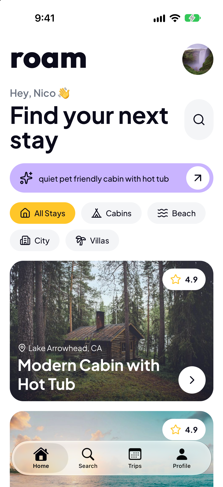
  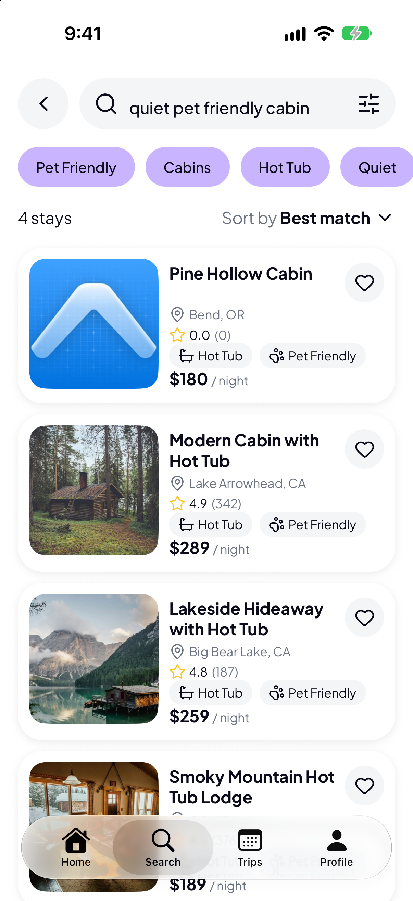
  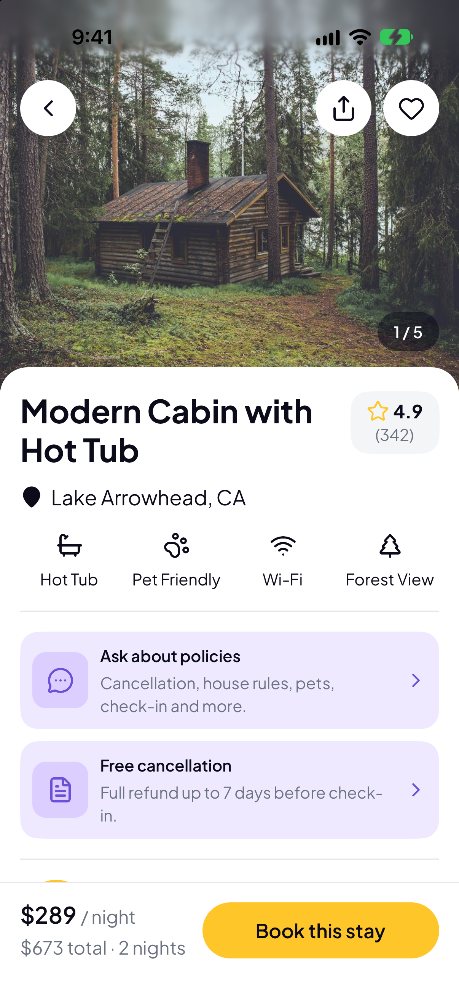
  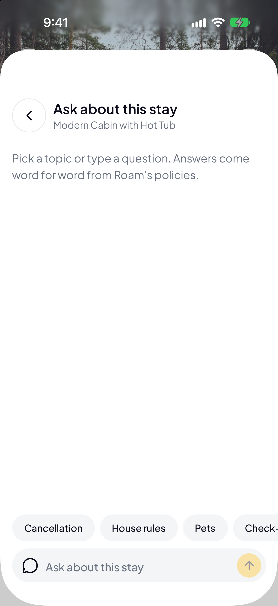
  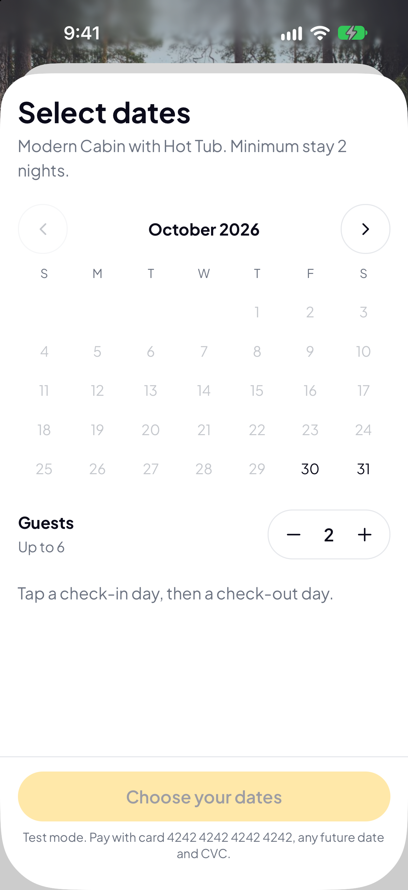
</p>

## Try it

Roam is a demo. Payments run in Stripe test mode, so no real money moves, and the stays and photos are samples.

- **Android:** download the APK from the [latest release](https://github.com/nico-TheDev/roam/releases/latest) and install it (allow installs from your browser). It talks to the hosted API.
- **iOS:** there is no iOS build to share yet (it needs an Apple Developer account). The screenshots below show the iOS app.
- **Sign in** with the demo account, or create your own with an email:

  | | |
  | --- | --- |
  | Email | `demo+clerk_test@example.com` |
  | Password | `RoamDemo-2026-Stay` |
  | New-device code | `424242` |

  The demo account is shared, so saved stays and bookings made on it are visible to the next person.
- **Pay** with the Stripe test card `4242 4242 4242 4242`, any future expiry, any CVC.
- Search and policy questions call a paid model, so there is a daily cap. If it is used up, search falls back to a simpler reading and Ask says to try tomorrow.

## Screenshots

| Find | Stay | Book and manage |
| --- | --- | --- |
|  |  |  |
|  | 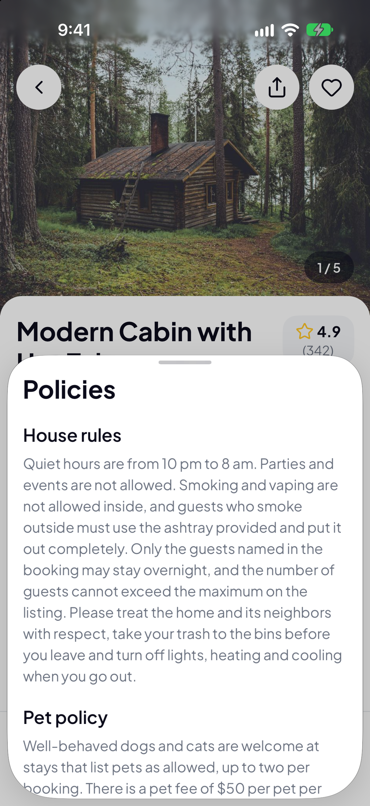 | 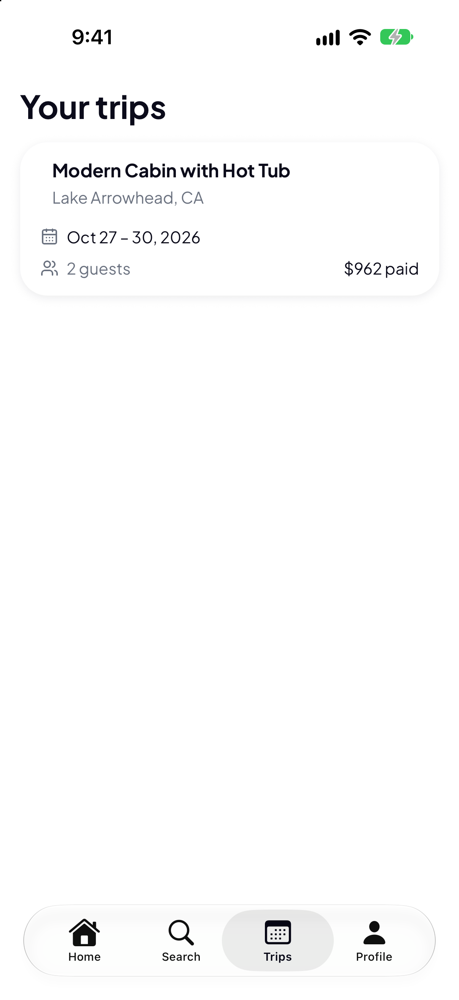 |
| 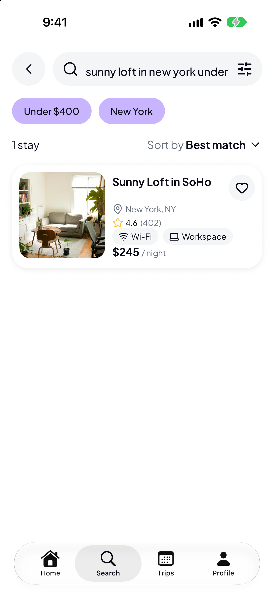 |  | 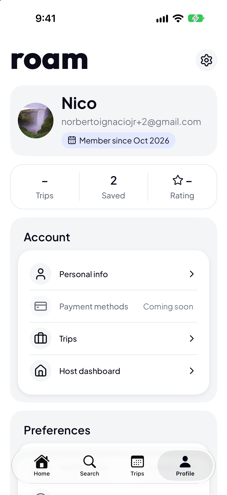 |
| 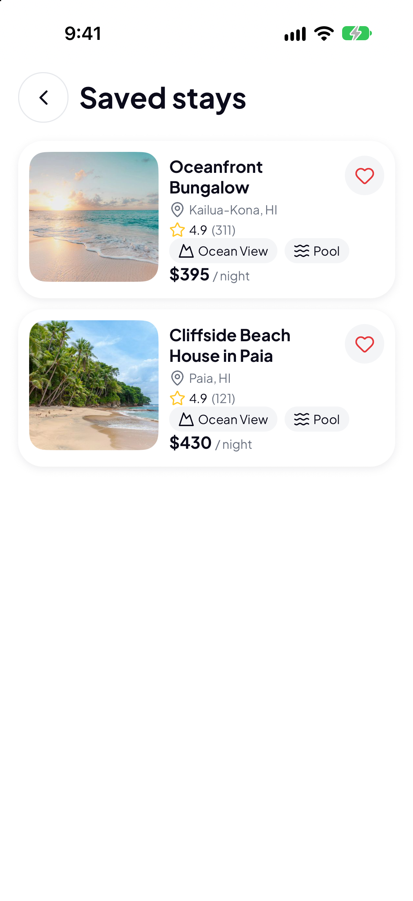 | 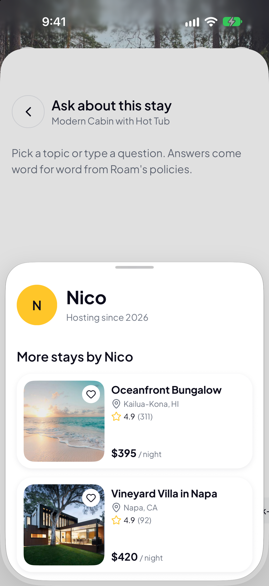 | 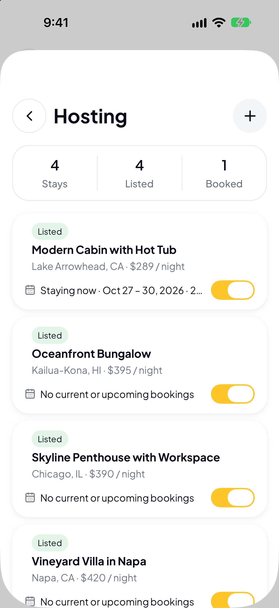 |

More: [add a stay](docs/screenshots/14-add-stay.png), [manage a stay](docs/screenshots/15-manage-stay.png), [settings](docs/screenshots/11-settings.png), [personal info](docs/screenshots/12-personal-info.png), [onboarding](docs/screenshots/19-onboarding-1.png), [sign up](docs/screenshots/20-sign-up.png), [sign in](docs/screenshots/21-sign-in.png).

## Architecture

The app and its API routes are one Expo project. API routes (`src/app/api/*+api.ts`) run on EAS Hosting (Cloudflare Workers). Every route verifies the Clerk session and counts the call before doing any work.

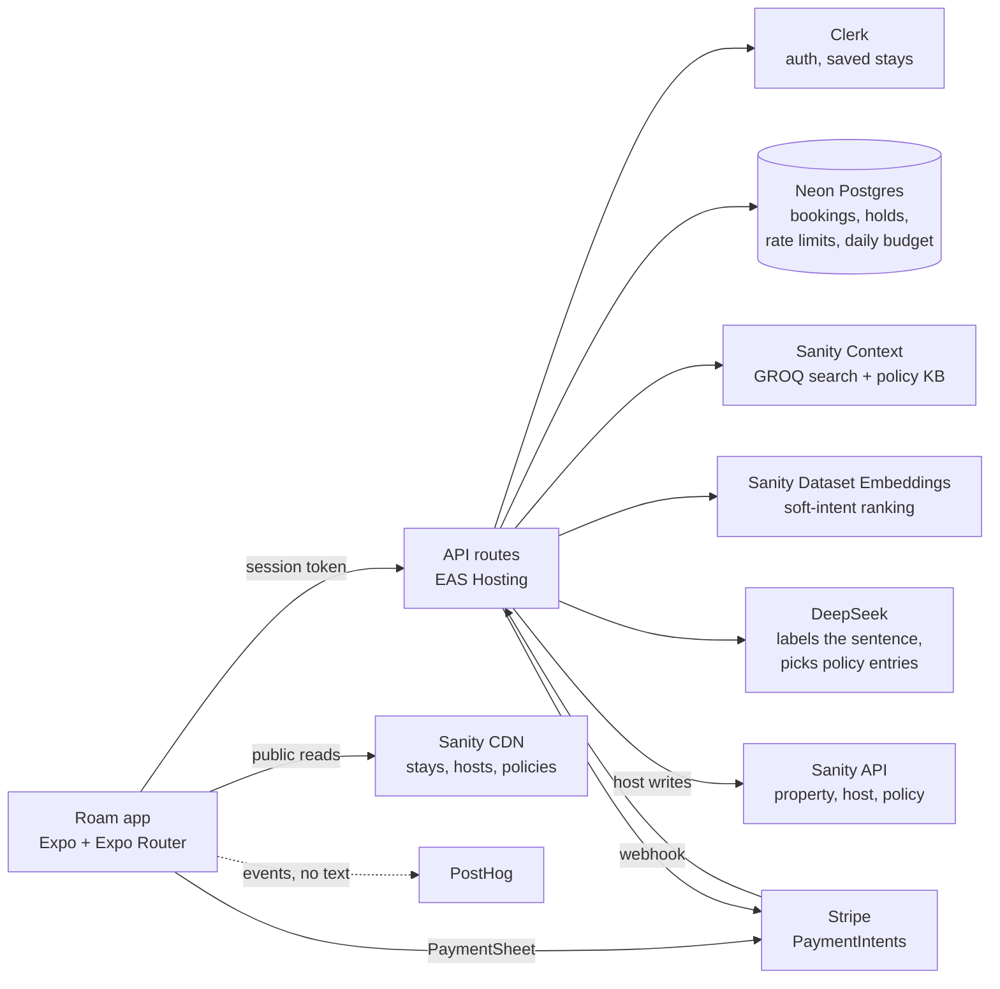

Repository layout:

| Path | What it is |
| --- | --- |
| `src/app/` | Screens (Expo Router) and API routes |
| `src/components/` | Shared design-system components, shown at `/design-system` |
| `src/lib/` | Hooks, search and booking logic, server helpers, database schema |
| `studio/` | Sanity Studio (the only content schema) and seed scripts |
| `landing/` | Astro marketing site, separate `package.json` |
| `drizzle/` | Postgres migrations |
| `prompts/` | Plan for each feature, as history |
| `AGENTS.md` | Every decision that is still true |

## Decisions

The full list is in [AGENTS.md](AGENTS.md). The ones that shape the app:

- **Code finds the options, the model only labels them.** Prices, guest counts, places and dates are parsed in code. DeepSeek says whether a vibe or amenity is wanted or avoided and what a number means, and anything off the list falls back to a regex reading.
- **Hard constraints are GROQ filters, soft intent is embeddings.** Price, guests, type, amenities, pets and place filter. "Quiet" and "cozy" only rank, using text on the property itself. The query is built from allowlisted literals, so guest text never enters it.
- **No model writes shown text.** Policy answers are Roam's own entries, word for word, with their source. The model only picks which entries, and if none fit the app says so and points to support.
- **Clerk owns auth and private data.** Saved stays live in Clerk metadata, not in the public Sanity dataset.
- **The server prices every booking.** The app never sends an amount. A booking exists only after Stripe confirms payment, and database constraints make double-booking impossible.
- **Hosts own their stays.** Ownership is an HMAC of the Clerk user ID, never the raw ID, because the dataset is public. Generated stay copy is checked for invented facts before it is written.
- **Spend is capped twice.** Per-user and per-address rate limits, plus a global daily budget for paid calls, both counted in Neon.
- **One tool per job.** Sanity for content, Clerk for auth, Neon for bookings, Stripe for payments. Moving a job to another tool is a deliberate change.

## Run it yourself

You need your own Clerk, Sanity, Neon, Stripe (test mode) and DeepSeek accounts. Copy the variable names from `.env.example` into `.env` (never commit it).

```bash
npm install
npx drizzle-kit migrate      # create the database tables
npx expo start               # press i for the iOS simulator
npx expo lint
npx tsc --noEmit
```

Native modules (Stripe, SVG) need a development build rather than Expo Go for custom builds: `npx expo run:ios`.

Content and seed data:

```bash
cd studio
npx sanity schema deploy && npx sanity deploy
npx sanity exec scripts/seed.ts --with-user-token
```

Landing page:

```bash
cd landing && npm install && npm run dev
```

Android APK for testers (EAS):

```bash
npx eas-cli@latest build --platform android --profile production-apk
```

## Notes

- Stripe is test mode only. The server refuses a live key unless `BOOKINGS_LIVE=1`.
- Clerk runs on a development instance, which is why the demo account uses a `+clerk_test` email with a fixed code.
- Stay photos are Unsplash placeholders and the stays are seeded samples.
